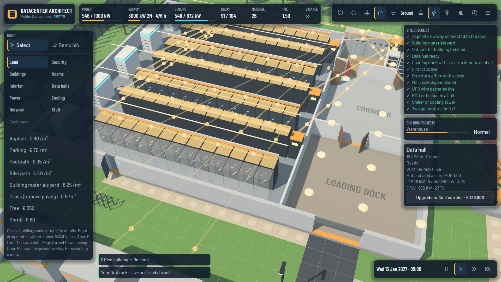
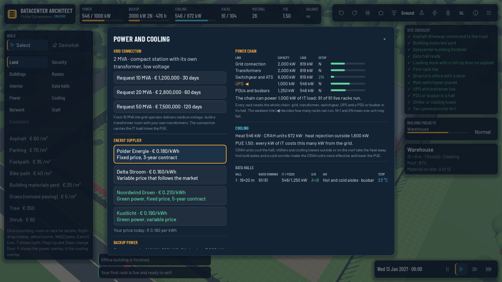
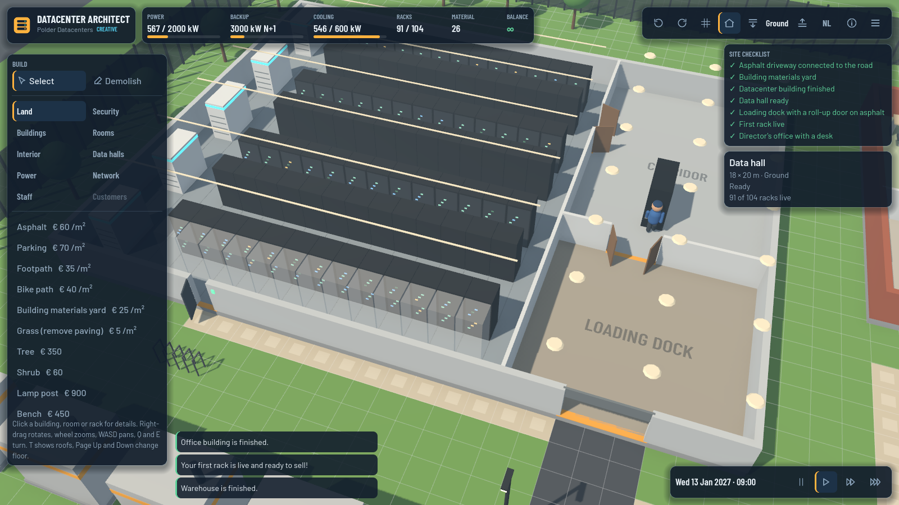

<p align="center"></p>

# Datacenter Architect

An offline building and management sim for Windows 11, macOS and Linux. Buy land, design the whole site from parking lot to data hall, keep power, cooling and fiber in balance, and grow your datacenter.

*Een offline bouw- en managementsimulatie voor Windows 11, macOS en Linux. Koop grond, ontwerp het hele terrein van parkeerplaats tot datazaal, houd stroom, koeling en glasvezel in balans en laat je datacenter groeien.*

**[Player guide](https://rhisijmuiden.github.io/datacenter-architect/)**: what you can do in the game, your first datacenter step by step, every room, power and redundancy, cooling, network, tips and troubleshooting. Also in Dutch: [Spelershandleiding](https://rhisijmuiden.github.io/datacenter-architect/nl/).

## Status

Step 4: power and cooling. Every rack needs the whole power chain: grid connection (2 to 50 MVA, with lead times), transformers, switchgear with ATS, UPS with batteries, and PDUs or a busbar with A/B feeds. Generators run N+1 with diesel tanks above or under ground. CRAH units, chillers and cooling towers (outside or on the roof) keep the halls cool; hall upgrades to hot/cold aisles and a cold corridor lower the PUE. P and H show power and cooling overlays with moving dots.

Step 3 added building and creative mode: paving, fences, a materials yard, trucks and construction workers, floors, rooms and doors, and the rack delivery chain.





Design material:

- [Game design document](docs/game-design.md) (Dutch)
- [Brand guide](brand/BRAND.md) and [design tokens](brand/tokens.json)
- Interactive sketches in [docs/concept](docs/concept) (open the `.html` files in a browser): concept, art style, room designer, site planner

## Tech

- Godot 4.5 with C# (.NET 8), project in [`game/`](game)
- Windows 11 installer (Inno Setup, per-user install, no admin prompt), universal macOS app (.dmg) and Linux x86_64 build (.tar.gz with [`install.sh`](installer/linux/install.sh) for the application menu)
- English by default, fully translated to Dutch: [`game/locale/strings.tsv`](game/locale/strings.tsv)
- Local savegames and three rotating autosaves in `%APPDATA%\Datacenter Architect\saves` (macOS: `~/Library/Application Support/Datacenter Architect/saves`, Linux: `~/.local/share/Datacenter Architect/saves`)
- Updates via GitHub Releases, checked and installed from the in-game Info screen

## Developing

```bash
# once: install Godot 4.5.1 (.NET edition) and the .NET 8 SDK
godot --headless --path game --import        # import assets
dotnet build game/DatacenterArchitect.csproj # compile C#
godot --path game                            # run the game
godot --headless --path game -- --run-tests  # run the tests (exit code 0 = pass)
```

Controls: right-drag rotates, mouse wheel zooms, WASD or middle-drag pans, Q/E turn 90°, R rotates the object you are placing, T shows or hides roofs, Page Up/Down change floor, Space pauses, 1/2/3 set the speed, F5 saves, Esc opens the menu.

## Releasing

Releases are built on GitHub by [`.github/workflows/release.yml`](.github/workflows/release.yml) when a tag is pushed, or when you run the workflow from the Actions tab with a version number. It stamps the version and channel, runs the tests, exports the Windows, macOS and Linux builds and attaches `DatacenterArchitect-<version>-Setup.exe`, `-macOS.dmg`/`-macOS.zip` and `-Linux-x86_64.tar.gz` (each with a `.sha256`) to a GitHub Release.

```bash
git checkout test && git tag v0.2.0-test.1 && git push origin v0.2.0-test.1   # test channel (pre-release)
git checkout main && git tag v0.2.0 && git push origin v0.2.0                 # stable channel
```

The game's Info screen reads these releases: the Stable channel sees normal releases, the Test channel also sees pre-releases.

## Branches

| Branch | Channel | Purpose |
|---|---|---|
| `main` | Stable | Production releases |
| `test` | Test | Pre-releases for testing |

The in-game Info screen lets the player choose the channel and update from there.
